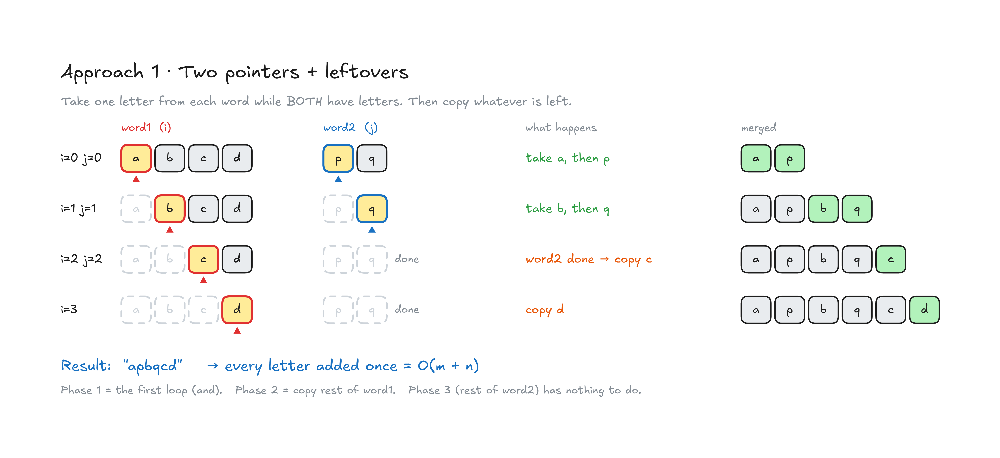
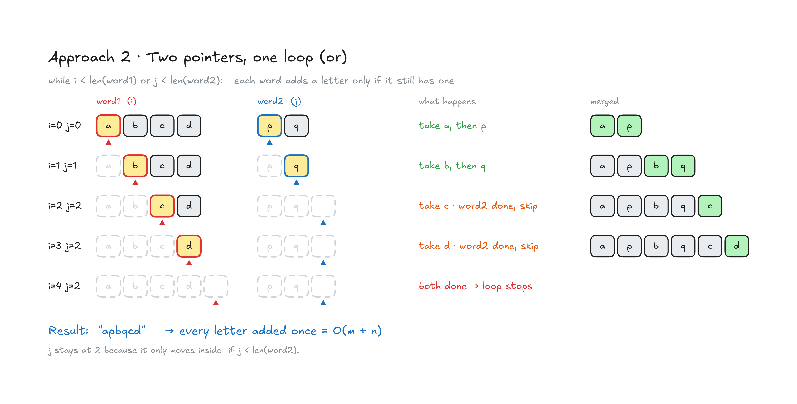
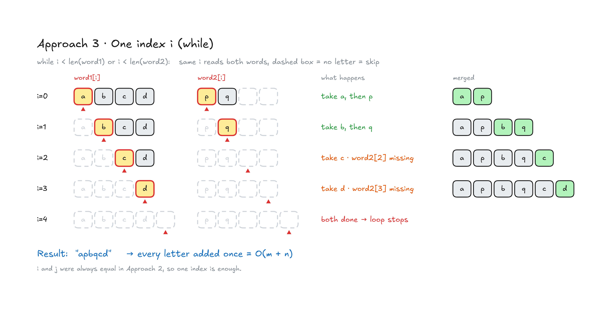
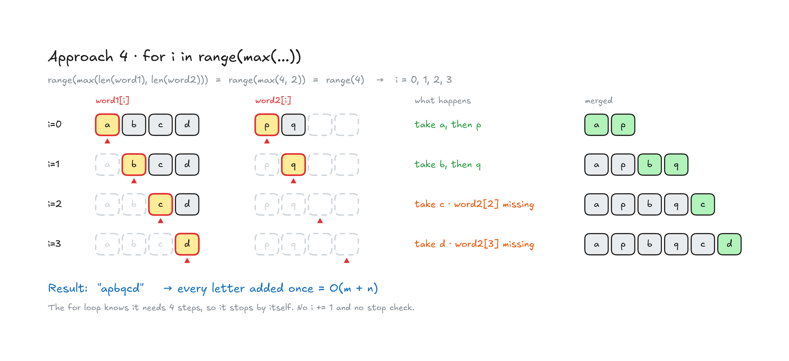

# 1768. Merge Strings Alternately

**Difficulty:** Easy · **Topic:** Two Pointers, String · **List:** LeetCode 75 (Array / String)
**Link:** https://leetcode.com/problems/merge-strings-alternately/

## Problem

You are given two strings `word1` and `word2`. Merge the strings by adding letters in alternating order, starting with `word1`. If a string is longer than the other, append the additional letters onto the end of the merged string.

Return the merged string.

| Input | Output | Note |
|---|---|---|
| `word1 = "abc"`, `word2 = "pqr"` | `"apbqcr"` | same length |
| `word1 = "ab"`, `word2 = "pqrs"` | `"apbqrs"` | `"rs"` appended |
| `word1 = "abcd"`, `word2 = "pq"` | `"apbqcd"` | `"cd"` appended |

**Constraints:** `1 <= word1.length, word2.length <= 100`, lowercase English letters only.

> All diagrams below use **Example 3** (`"abcd"`, `"pq"`), because it shows how the leftover letters are handled.
>
> **How to read the diagrams:** yellow box + ▲ = current position (red = `i`, blue = `j`) · dashed box = already used / no letter there · green = letter just added to `merged` · green note = normal step · orange note = one word is finished

---

## Approach 1: Two Pointers + Leftovers

### Idea

Keep one pointer per string:

1. **Phase 1:** while **both** strings still have letters, take one from `word1`, then one from `word2`.
2. **Phase 2:** if `word1` still has letters, copy them all.
3. **Phase 3:** if `word2` still has letters, copy them all.

Only one of Phase 2 / Phase 3 can actually do any work, because Phase 1 stops as soon as *one* string runs out.



### Code

```python
class Solution(object):
    def mergeAlternately(self, word1, word2):
        """
        :type word1: str
        :type word2: str
        :rtype: str
        """

        i = 0
        j = 0
        merged = []

        while i < len(word1) and j < len(word2):
            merged.append(word1[i])
            merged.append(word2[j])
            i += 1
            j += 1

        if i != len(word1):
            while i < len(word1):
                merged.append(word1[i])
                i += 1

        if j != len(word2):
            while j < len(word2):
                merged.append(word2[j])
                j += 1

        return "".join(merged)
```

### Complexity

Let `m = len(word1)`, `n = len(word2)`.

| | | Why |
|---|---|---|
| **Time** | `O(m + n)` | Every letter is appended once, and `"".join` is linear. |
| **Space** | `O(m + n)` | The `merged` list holds every letter, which is also the size of the answer. |

> 💡 The `if i != len(word1):` / `if j != len(word2):` lines are not needed. The `while` already checks the same thing, so with nothing left it just runs 0 times.

---

## Approach 2: Two Pointers, One Loop (`or`)

### Idea

Instead of three loops, use **one** loop that keeps going while **either** string still has letters (`or`).
Inside, take a letter from each string **only if that string still has one**.

When `word2` runs out, its `if` is simply skipped and `j` stops moving, while `word1` keeps going.



### Code

```python
class Solution(object):
    def mergeAlternately(self, word1, word2):
        """
        :type word1: str
        :type word2: str
        :rtype: str
        """
        i=0
        j=0
        merged =""
        while i<len(word1) or j<len(word2):
            if i< len(word1):
                merged = merged + word1[i]
                i=i+1
            if j < len(word2):
                merged = merged + word2[j]
                j=j+1
        return merged
```

### Complexity

| | | Why |
|---|---|---|
| **Time** | `O(m + n)` | One loop. Each step adds 1–2 letters, so it runs `max(m, n)` times. |
| **Space** | `O(m + n)` | The `merged` string holds every letter. |

---

## Approach 3: One Index `i` (`while`)

### Idea

Look at Approach 2 again: `i` and `j` are **always equal** while both words have letters. So we only need **one** index `i` and can read `word1[i]` and `word2[i]` at the same position.

- If `word1` has a letter at `i`, add it.
- If `word2` has a letter at `i`, add it.
- Move `i` forward.



### Code

```python
class Solution(object):
    def mergeAlternately(self, word1, word2):
        count = ""
        i = 0
        while i<len(word1) or i<len(word2):
            if i<len(word1):
                count += word1[i]
            if i<len(word2):
                count += word2[i]
            i += 1
        return count
```

### Complexity

| | | Why |
|---|---|---|
| **Time** | `O(m + n)` | The loop runs `max(m, n)` times. |
| **Space** | `O(m + n)` | The result string. |

---

## Approach 4: `for i in range(max(...))`

### Idea

Same idea as Approach 3, but we know **in advance** how many steps we need: the length of the **longer** word.
So a `for` loop replaces the `while`, and we don't need to write `i += 1` ourselves.

`range(max(len("abcd"), len("pq")))` is `range(4)`, so `i = 0, 1, 2, 3`.



### Code

```python
class Solution(object):
    def mergeAlternately(self, word1, word2):
        result = ""

        for i in range(max(len(word1), len(word2))):
            if i < len(word1):
                result += word1[i]

            if i < len(word2):
                result += word2[i]

        return result
```

### Complexity

| | | Why |
|---|---|---|
| **Time** | `O(m + n)` | `max(m, n)` iterations, at most 2 letters added each. |
| **Space** | `O(m + n)` | The result string. |

---

## Comparison

| # | Approach | Loops | Pointers | Time | Space |
|---|---|---|---|---|---|
| 1 | Two pointers + leftovers | 3 | `i`, `j` | `O(m + n)` | `O(m + n)` |
| 2 | Two pointers, one loop (`or`) | 1 | `i`, `j` | `O(m + n)` | `O(m + n)` |
| 3 | One index (`while`) | 1 | `i` | `O(m + n)` | `O(m + n)` |
| 4 | One index (`for range(max)`) | 1 | `i` | `O(m + n)` | `O(m + n)` |

All four are optimal. Every letter has to be read and written, so `O(m + n)` is the best possible.
**Approach 4 is the cleanest to write in an interview:** one loop, one index, and no manual `i += 1`.

### Small note: `list + join` vs `string +=`

- Approach 1 collects letters in a **list** and joins once at the end. This is always linear.
- Approaches 2–4 use **`result += letter`**. Strings can't be changed in place, so in theory each `+=` makes a new copy, which is `O((m+n)²)` in the worst case. In practice CPython optimizes this pattern, and with lengths ≤ 100 it doesn't matter at all. It's still worth mentioning in an interview.

## Key takeaways

- **Two sequences, one by one:** loop while *either* still has items (`or`), and guard each with `if i < len(...)`.
- If both pointers always move together, **one index is enough**.
- If you know the number of steps up front, a `for` loop is cleaner than `while`.
- The same "walk two sequences together" pattern comes back in **Merge Sorted Array (88)** and the merge step of **Merge Sort**.
